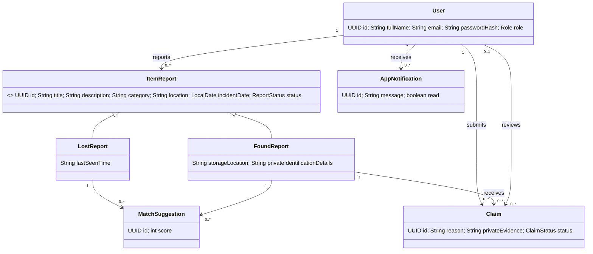
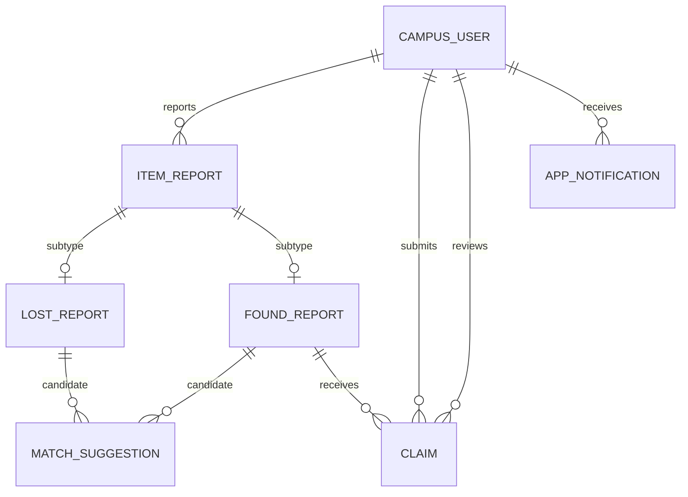
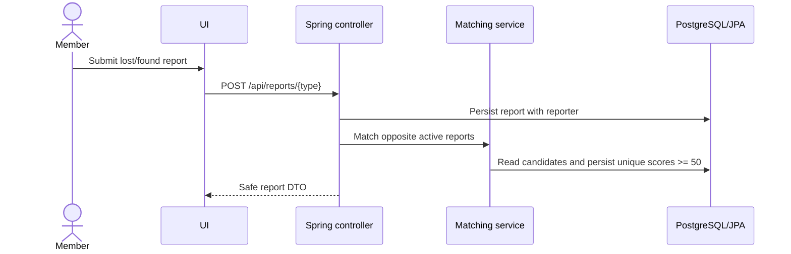
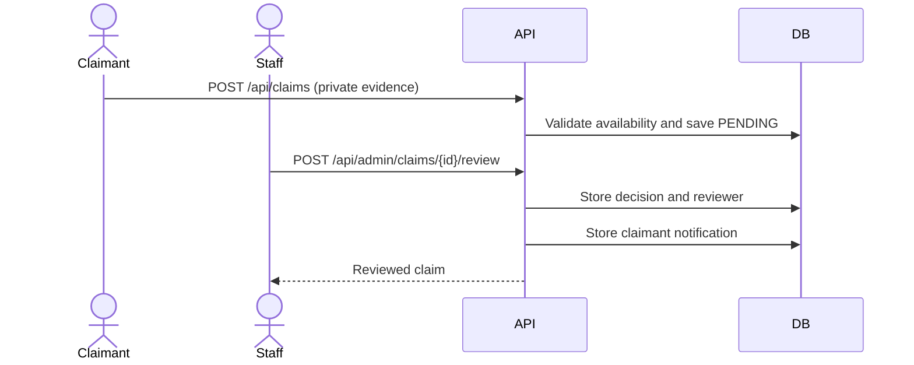
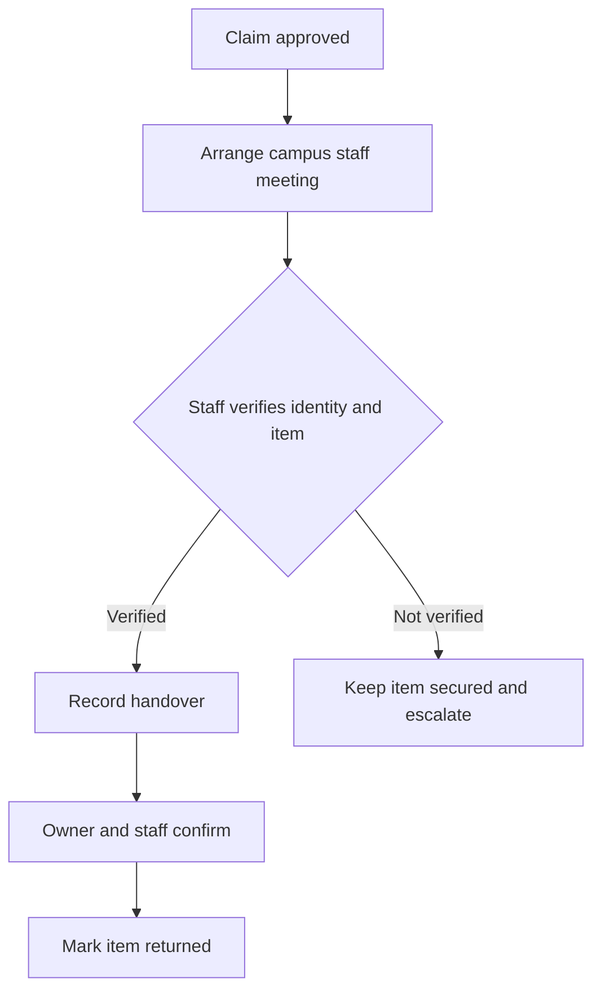
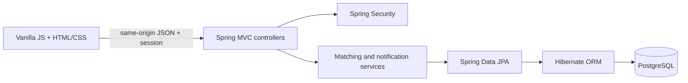
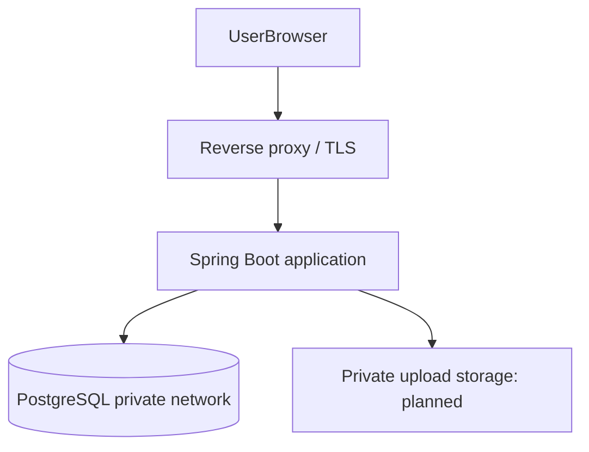
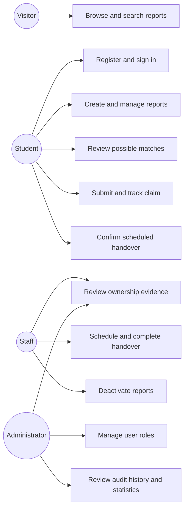

# Editable software design diagrams (Mermaid)

## UML class/domain diagram

## ER diagram

## Report submission sequence

## Claim review sequence

## Handover activity

## Components

## Deployment

## Use case diagram

